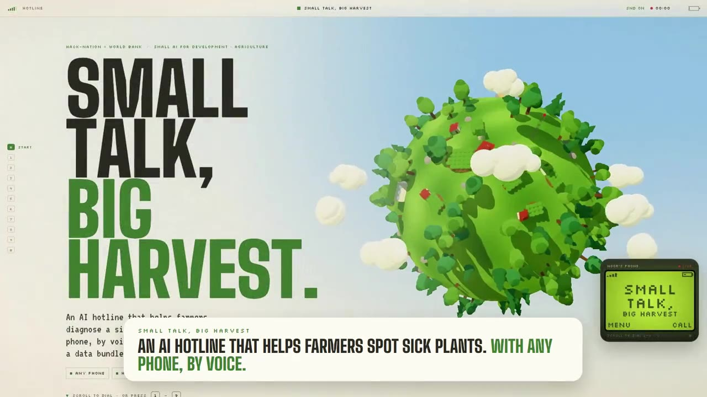

# Small Talk, Big Harvest

**An AI hotline for farmers. Any phone. Voice in Hindi. No data bundle. A person when unsure.**

A farmer calls a number from a basic phone and describes in Hindi what she sees on her coffee plants. A few minutes later she hears a safe, expert-written answer: *healthy*, *the likely disease and one safe next step*, or *"we are not sure, an extension officer will call you"*.

> 🏆 Built at the **Hack-Nation** hackathon × World Bank, *Small AI for Development*, Challenge 04, **Agriculture** track.

## 🎬 Pitch video

[](docs/small-talk-pitch.mp4)

*Click the image to play the 60-second pitch ([`docs/small-talk-pitch.mp4`](docs/small-talk-pitch.mp4)). Interactive version: [gt-code-24.github.io/small-talk-big-harvest](https://gt-code-24.github.io/small-talk-big-harvest).*

---

## The problem

- **Disease moves faster than advice.** Coffee leaf rust, berry disease and wilt spread through a farm in weeks. A smallholder may see an extension officer only once or twice a year.
- **Most help assumes a smartphone and literacy.** Plant-doctor apps need a camera, a data bundle and reading. Many farmers have a basic phone, little or no data, and some cannot read or write.
- **Menus can't describe a sick plant.** A keypad menu ("press 1 for spots") can't capture *"पत्तियों के नीचे नारंगी पाउडर है और पत्ते गिर रहे हैं"* (orange powder under the leaves and the leaves are falling).
- **Wrong advice is worse than none.** A chatbot that makes up a diagnosis or a spray dose can cost a farmer her harvest, or her health.

## Our solution

A **voice hotline** that works on any phone, with no app, no data and no reading:

1. **Call.** The farmer dials the number and describes the problem in her own words, in Hindi. SMS works too.
2. **Understand.** Speech AI turns her voice into text. A *small* language model turns that text into a fixed checklist of 24 symptoms.
3. **Decide with rules, not AI.** A transparent matcher compares the symptoms with a coffee-disease knowledge base, adjusted a little by the past weeks' weather at her farm.
4. **Answer safely.** She hears **pre-written, pre-recorded** advice from experts. The AI never writes a word of it.
5. **When in doubt, a person decides.** Unclear cases go to a review queue. An extension officer labels them and calls back, and each label teaches the system.

| Answer | Example |
|---|---|
| ✅ **Healthy** | "आपका कॉफ़ी का पौधा स्वस्थ दिखता है।" (Your coffee plant looks healthy.) |
| 🩺 **Disease (sure)** | "आपके पौधे को शायद कॉफ़ी पत्ती का रतुआ रोग है। भरोसा: ऊँचा। …" (Likely coffee leaf rust. Confidence: high. One safe step…) |
| ❓ **Not sure** | "हमें पक्का नहीं पता। कृषि विस्तार अधिकारी आपको फ़ोन करेंगे।" (We are not sure. The extension officer will call you.) The case goes to the **human review queue**. |

---

## How it works

### The call

```
☎  Farmer dials  →  "स्मॉल टॉक में आपका स्वागत है।"  →  "Describe what you see on your coffee…" → beep
   →  she speaks (up to 30 s)  →  "please wait"  →  the answer is played  →  goodbye
```

No menus. Key **9** during the welcome deletes all of the caller's data. Her audio is used only for this answer, then deleted.

### The pipeline

```
Farmer's phone (voice / SMS)
   → Twilio (+ ngrok in the demo)                       [Africa's Talking in production]
   → FastAPI server
        1. Speech-to-text     faster-whisper large-v3-turbo on our machine   → fallback: Whisper large-v3 (Together AI)
        2. Symptom flags      gemma3:4b via Ollama on our machine            → fallback: Qwen3.5-9B (Together AI)
                              output forced into a JSON schema: 24 symptoms, each yes / no / unknown
        3. Keyword check      Hindi keyword list fills missed words and blocks invented symptoms
        4. Match              score + margin rules over the knowledge base (+ small weather nudge)
        5. Answer             human-written text + recorded audio from answers/hi.json
   → SQLite (demo) / PostgreSQL; audio deleted after the answer
   → Expert review page → verified case → knowledge base
```

### What the LLM does, and what it does not

The LLM (`app/pipeline/extract.py`) has **one job: fill in a form.** It receives a system prompt with the 24 symptom names, 10 Hindi worked examples (`config/fewshot.yaml`) and the farmer's sentence. It must return JSON matching a fixed schema, at temperature 0:

```
"पत्तियों के नीचे नारंगी पाउडर है और ऊपर पीले धब्बे हैं, पत्ते नहीं गिर रहे।"
        ↓ LLM
{ "orange_powder_under_leaf": 1, "yellow_spots_on_leaf": 1, "leaves_falling": -1, …21 more: 0 }
```

- **The output is validated** with Pydantic. If it is invalid, the same model gets one retry, then the next model.
- **It is cross-checked** with a Hindi keyword list (`config/lexicon/hi.yaml`, negation-aware: *"नहीं गिर रहे"* means *not* falling). If the LLM and the keywords disagree, the symptom becomes "unknown". For the small local model, every "yes" must also be confirmed by a keyword, so it can't invent symptoms.
- **It never sees the knowledge base, never picks the disease and never writes advice.** It only understands the words.

### How the knowledge is used

The knowledge base (`knowledge/coffee_disease_knowledge_base.xlsx`) was turned into **disease profiles** (`config/profiles.yaml`, loaded into the database by `scripts/seed_db.py`) and **advice texts** (`answers/hi.json`). For example:

```yaml
leaf_rust: { yellow_spots_on_leaf: 1, orange_powder_under_leaf: 1, leaves_yellowing: 1, leaves_falling: 1 }
```

The matcher (`app/pipeline/match.py`) uses only the symptoms the farmer actually mentioned:

1. Fewer than 2 known symptoms → **not sure** (`too_few_symptoms`). The exception is one symptom that only a single disease has.
2. Score each profile: **1.0** if it agrees, **0.5** if the farmer says "no" to a symptom the disease doesn't involve, **0** if it contradicts or isn't explained. Then average.
3. A disease's score is its best row: the seed profile or any **expert-verified case**.
4. Past weather at the farm (Open-Meteo) adds at most **+0.1**. It can break a tie but never answers by itself.
5. Best score below **0.75** → not sure (`weak_match`). Top two within **0.15** → not sure (`too_close`). Otherwise the answer is the best disease.

**The system learns only from people:** when an officer labels a "not sure" case on the review page, its symptoms become a new `verified_case` profile. The next farmer who describes the same thing gets a sure answer.

---

## Guardrails

| Rule | How it is enforced |
|---|---|
| **The LLM never writes advice** | It only fills a 24-key JSON schema (`-1/0/1`), validated with Pydantic. Every sentence the farmer hears or reads comes from human-written `answers/hi.json`. |
| **"Not sure" is a first-class answer** | Reasons: `too_few_symptoms`, `weak_match`, `too_close`, `low_asr_confidence`, `extraction_failed`, `timeout`. Any error → "not sure" → a person reviews. |
| **Only humans update the knowledge** | Only the expert review form (`app/routes/review.py`) adds `verified_case` rows. The system never learns from its own predictions. |
| **Privacy** | Call audio is deleted after the answer, and Twilio's copy after download. Phone numbers are hashed (SHA-256 + salt) and Fernet-encrypted only for the officer callback. No phone numbers or transcripts in INFO logs (tested). The model call log holds transcripts but never phone numbers, and is deleted after `RETENTION_DAYS`. Key **9** deletes all of the caller's data. |
| **Safe advice** | One safe step only. Wilt: *"call the officer to confirm before removing the tree"*, because a phone diagnosis is only "likely". No pesticide doses: *"ask the extension officer which registered product to use"*. |

## Built today vs. roadmap

| In the pitch video | Status |
|---|---|
| Call from any phone, speak Hindi, no menu | ✅ built (Twilio voice) |
| Speech → symptoms → safe answer during the call | ✅ built |
| SMS in, SMS answer out | ✅ built (`/sms/incoming`) |
| Weather at her field | ✅ built (Open-Meteo, demo page location) |
| "When in doubt, a person decides" (review queue, officer labels) | ✅ built (`/review`) |
| Read the symptoms back and wait for *"हाँ"* before advising | 🔜 next |
| Field elevation, neighbours' reports, plot memory | 🔜 roadmap |
| Answer also sent by SMS after the call | 🔜 roadmap |
| Photo check, weather alerts, officer dashboard | 🔜 roadmap |

## Models and hosting

| Step | Primary (on our machine) | Fallback (hosted) |
|---|---|---|
| Speech-to-text | faster-whisper `large-v3-turbo` (GPU int8, CPU if no GPU) | Together AI `openai/whisper-large-v3` |
| Symptom extraction | Ollama `gemma3:4b` (~22 s per call) + Hindi keyword check | Together AI `Qwen/Qwen3.5-9B` (~3 s) |

- **Local first, as the challenge asks (no paid cloud AI by default).** All models are open-weights. Together AI is used only when the local model fails, so the farmer still gets an answer. Set `LLM_FALLBACK=` / `STT_FALLBACK=` to run fully offline.
- **Missing models download themselves:** Whisper on first use, and `gemma3:4b` through Ollama at startup (`OLLAMA_AUTO_PULL=true`).
- Hosted calls are **retried once** on timeouts or rate limits. If everything fails, the farmer hears "not sure".
- Every case records which models answered it. `GET /health?deep=true` shows which backends are reachable.

## Knowledge base

Source: `knowledge/coffee_disease_knowledge_base.xlsx` (team-provided), converted into `config/symptoms.yaml` (24 symptoms), `config/profiles.yaml` and the advice in `answers/hi.json`.

| Condition | Cause | Key signs the farmer may mention |
|---|---|---|
| Coffee leaf rust | *Hemileia vastatrix* | yellow spots on top, orange powder underneath, leaves falling |
| Coffee berry disease | *Colletotrichum kahawae* | dark sunken spots on green berries, berries shrivel and fall, wet weather |
| Coffee wilt disease | *Fusarium xylarioides* | wilting, dry leaves stay attached, branch dieback, dark wood inside the stem |
| Brown eye spot | *Cercospora* spp. | round brown spots with a grey centre and dark border |
| Root rot | soil-borne fungi | poor growth, yellowing, wilting, dark soft roots, waterlogged soil |
| Coffee berry borer | *Hypothenemus hampei* | tiny hole in the berry, insects or tunnels inside |
| Green coffee scale | *Coccus viridis* | small green insects on leaves and stems, sticky leaves, black sooty mould, ants |
| Coffee berry rot | various fungi | soft, rotten, mouldy berries after long rain |

If you change the workbook, also update `config/profiles.yaml` and `answers/hi.json`, then run `python scripts/seed_db.py`.

---

## Quick start

Requirements: Python 3.11+, `ffmpeg` on PATH, and [Ollama](https://ollama.com) installed and running. An NVIDIA GPU is optional. `gemma3:4b` and Whisper download themselves on first start.

```bash
python -m venv .venv
.venv\Scripts\activate                 # Windows   (Linux/macOS: source .venv/bin/activate)
pip install -r requirements.txt
cp .env.example .env                   # set FERNET_KEY, PHONE_SALT, REVIEW_PASSWORD (+ TOGETHER_API_KEY for the fallback)
python scripts/seed_db.py              # 9 profiles: 8 conditions + healthy
uvicorn app.main:app --port 8000
# other devices on your network: uvicorn app.main:app --host 0.0.0.0 --port 8000  (link printed at startup)
```

| What | Where |
|---|---|
| Browser demo (no phone needed): mic, upload or text | http://localhost:8000/demo |
| Expert review queue (basic auth) | http://localhost:8000/review |
| Command line | `python scripts/demo_cli.py --text "पत्तियों के नीचे नारंगी पाउडर है"` or `--audio clip.wav` |
| Tests (99) | `pytest` |

### Phone and SMS (Twilio + ngrok)

1. Set `NGROK_AUTHTOKEN` in `.env`: the server opens the tunnel itself at startup and prints the webhook URLs. Alternatively run `ngrok http 8000` and set `PUBLIC_BASE_URL=https://<id>.ngrok.app`.
2. In the Twilio console: Voice webhook `POST {PUBLIC_BASE_URL}/voice/incoming`, Messaging webhook `POST {PUBLIC_BASE_URL}/sms/incoming`.
3. Set `TWILIO_ACCOUNT_SID` and `TWILIO_AUTH_TOKEN`. Keep `TWILIO_VALIDATE=true` (every webhook's signature is checked).

**Call flow:** welcome (no menu; key 9 deletes my data) → describe prompt and beep (up to 30 s) → "please wait" while the pipeline runs in the background (the call checks every 3 s, up to ~5 min, `VOICE_MAX_TRIES`) → answer → goodbye.

**SMS:** always Hindi (an optional `HI` prefix is stripped). The first reply includes a one-line privacy notice.

**Retention:** run `python scripts/cleanup.py` daily. It deletes old cases with their audio, leftover audio and old model call logs (`RETENTION_DAYS`).

## Configuration (main `.env` settings)

| Setting | Default | Meaning |
|---|---|---|
| `STT_PROVIDER` / `STT_FALLBACK` | `local` / `together` | speech-to-text backend and its fallback |
| `LLM_PROVIDER` / `LLM_FALLBACK` | `ollama` / `together` | extraction backend and its fallback |
| `OLLAMA_AUTO_PULL` | `true` | pull `OLLAMA_MODEL` at startup / first use if it is missing |
| `OLLAMA_MODEL`, `OLLAMA_NUM_CTX` | `gemma3:4b`, `8192` | local LLM (the prompt is ~4.3k tokens) |
| `WHISPER_MODEL`, `WHISPER_DEVICE` | `large-v3-turbo`, `cuda` | local Whisper |
| `TOGETHER_RETRIES`, `TOGETHER_TIMEOUT` | `1`, `10` s | retry policy for the hosted fallback |
| `LEXICON_CHECK` | `always` | keyword cross-check: `always`, `local` (only the local model) or `off` |
| `MIN_KNOWN`, `SCORE_MIN`, `MARGIN_MIN` | `2`, `0.75`, `0.15` | when to say "not sure" |
| `SINGLE_SYMPTOM_ANSWER` | `true` | answer from one symptom if only one problem has it |
| `ASR_MIN_CONF` | `0.45` | low speech-recognition confidence → "not sure" |
| `WEATHER_ENABLED` | `true` | past weather at the farm nudges the match (Open-Meteo, no API key); rules in `config/weather.yaml` |
| `MODEL_LOG_DIR` | `./data/logs` | JSON-lines log of every STT/LLM call and case; empty = off |
| `VOICE_MAX_TRIES` | `100` | the call waits up to ~5 min before "not sure" |
| `RETENTION_DAYS` | `365` | automatic deletion |

## Weather reasoning

The demo page takes a farm location (📍 browser GPS or a typed village). Coordinates are rounded to ~1 km.

1. Open-Meteo returns the last 60 days of rain, temperature and humidity (free, no API key).
2. `app/pipeline/weather.py` turns them into facts per window (14–60 days): rain, rainy days, humid days, warm-wet days, wet and dry spells.
3. Rules in `config/weather.yaml` give each disease a weather score with a plain-language reason, for example *"12 warm rainy days in the last 6 weeks: rust spores need wet leaves and warmth"*.
4. The matcher adds at most +0.1. Weather breaks ties but never answers alone. If the service is down, the case is answered without weather.

The thresholds are a **draft** and need agronomist review.

---

## Results

Synthetic Hindi test set: 12 sentences (8 conditions, healthy, 3 cases that should get "not sure"), tested as text and as speech, with the hosted and the local model stack. **The hosted stack made no wrong diagnosis. The local stack made one** (a misheard word led gemma to invent a symptom; this run was before the Hindi keyword list existed). All other misses were honest "not sure" answers. Unit tests: 99 passed. The numbers below are Hindi rows from earlier runs; re-run the eval scripts to refresh them.

<!-- RESULTS:START -->
**Speech end to end: synthetic audio of the 36 test sentences → speech-to-text → extraction → diagnosis. Low `wrong` matters more than high `correct`.**

| stack | lang | n | correct | wrong | not_sure | mean_asr_conf | sec_per_case |
|---|---|---|---|---|---|---|---|
| openai/whisper-large-v3 + Qwen/Qwen3.5-9B | hi | 12 | 83% | 0% | 17% | 0.97 | 8.8 |
| large-v3-turbo (local) + gemma3:4b (local) | hi | 12 | 92% | 8% | 0% | 0.94 | 23.2 |

**Text end to end: test sentence → extraction → diagnosis (also what SMS does).**

| provider | model | lang | n | correct | wrong | not_sure |
|---|---|---|---|---|---|---|
| ollama | gemma3:4b | hi | 12 | 83% | 0% | 17% |
| together | Qwen/Qwen3.5-9B | hi | 12 | 100% | 0% | 0% |

**Symptom extraction: how many of the 24 symptom flags the LLM got right.**

| provider | model | lang | n | exact_match | symptom_accuracy | failed | sec_per_case |
|---|---|---|---|---|---|---|---|
| ollama | gemma3:4b | hi | 12 | 58% | 96% | 0 | 22.41 |
| together | Qwen/Qwen3.5-9B | hi | 12 | 92% | 94% | 0 | 3.26 |

**Speech recognition on FLEURS (25 real read-speech clips per language): word error rate (lower is better).**

| provider | model | lang | fleurs | n | wer | mean_asr_conf | below_min_conf | sec_per_clip |
|---|---|---|---|---|---|---|---|---|
| local | small | hi | hi_in | 25 | 0.343 | 0.685 | 1 | 13.47 |
| together | openai/whisper-large-v3 | hi | hi_in | 25 | 0.237 | 0.878 | 2 | 1.68 |
| local | large-v3-turbo | hi | hi_in | 25 | 0.151 | 0.92 | 0 | 1.74 |

Full report, including live scenarios and findings: [`eval/RESULTS.md`](eval/RESULTS.md).
<!-- RESULTS:END -->

Run them yourself: `python scripts/eval_asr.py`, `python scripts/eval_extract.py` (extraction + end-to-end), then `python scripts/report.py` to update this section.

## Data sources and licenses

| Item | Source | License |
|---|---|---|
| Disease knowledge base | `knowledge/coffee_disease_knowledge_base.xlsx` (team). **Citations still to add** (e.g. CABI PlantwisePlus, Coffee Board of India) | — |
| Speech-recognition eval audio | FLEURS (`google/fleurs`: hi_in) | CC-BY-4.0 |
| Test set, few-shot examples, Hindi keyword list | **Synthetic**, written by the team | ours |
| Prompt audio | Placeholder, generated with edge-tts; **replace with native-speaker recordings** | demo only |

**Models:** Whisper large-v3 / large-v3-turbo (MIT) · Qwen3.5-9B (Apache-2.0) · Gemma 3 (Gemma Terms of Use).

## Limits

- **Only 8 conditions.** Anything else (Phoma, leaf miner, nutrient deficiency, drought stress…) gets "not sure".
- The knowledge base **has no citations and is not agronomist-validated** yet.
- Advice texts and the Hindi keyword list are **drafts**. A native speaker and an agronomist must check them.
- **No real farmer recordings yet.** Tests use FLEURS (clean read speech) and our own sentences. Phone audio (8 kHz, noise), regional Hindi and Hindi-English mixing are harder.
- **Look-alikes** (wilt vs root rot, yellowing with leaf drop) give "not sure" unless a distinguishing sign is mentioned.
- The local stack is slower (~22 s per LLM call) than the hosted fallback (~3 s).

## Project layout

```
app/          FastAPI app: config, db, models, storage, privacy, health
  pipeline/   stt, extract (LLM), ollama (auto-pull), lexicon, match, weather, answer, run, resilience
  routes/     voice, sms, review, demo
config/       languages, symptoms, profiles, fewshot, lexicon/hi.yaml, weather
answers/      hi.json: every sentence the farmer hears
knowledge/    coffee disease knowledge base (xlsx)
static/audio/ Hindi prompts and answers
scripts/      seed_db, demo_cli, generate_audio, cleanup, check_offline, e2e_*, eval_*, report
eval/         test set and results
docs/         pitch video
tests/        pytest suite
```

Adding another language needs `config/languages.yaml`, `answers/xx.json`, `static/audio/xx/`, examples in `config/fewshot.yaml`, optionally `config/lexicon/xx.yaml`, and a language menu in `app/routes/voice.py`.

**Out of scope:** image diagnosis, prices, farmer registry, production deployment, multi-tenant auth.

## Team

**Mahmoud Ahmed Alfourawi · Bhati Shashank · Jörg Heseler · Gabriel Tsonyev**

Built at the **Hack-Nation** hackathon × World Bank, *Small AI for Development*, Agriculture track.
